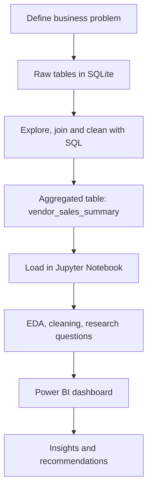
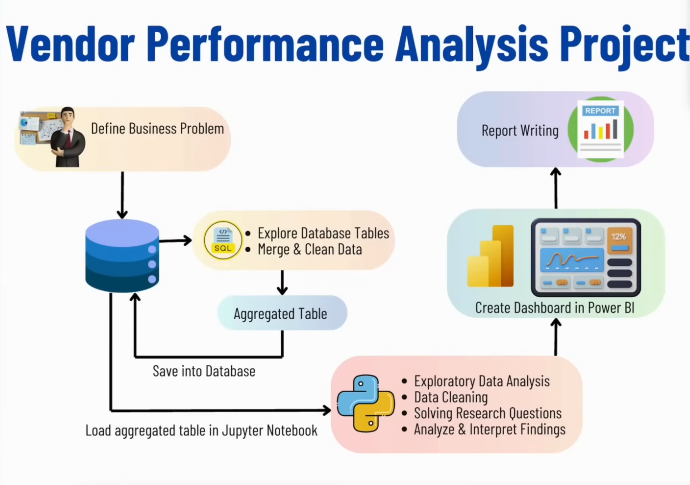
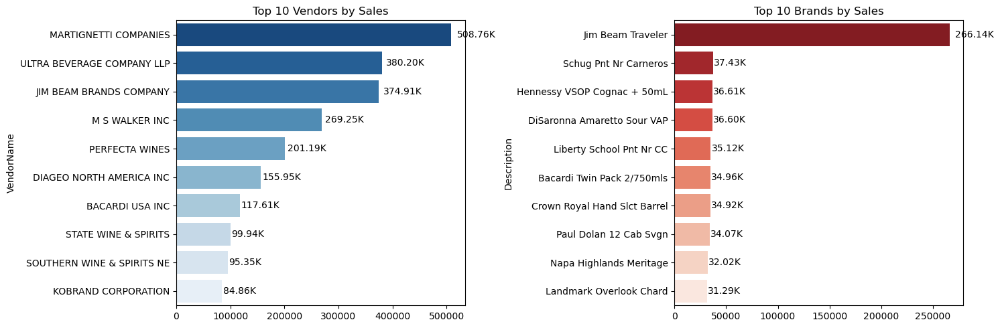
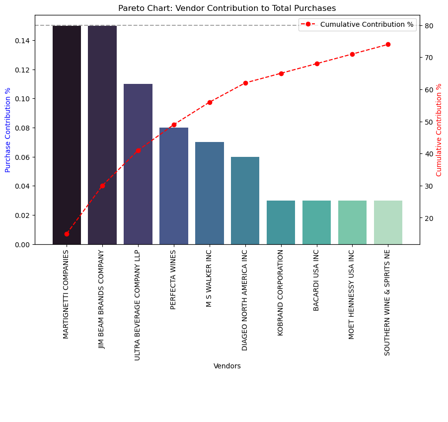
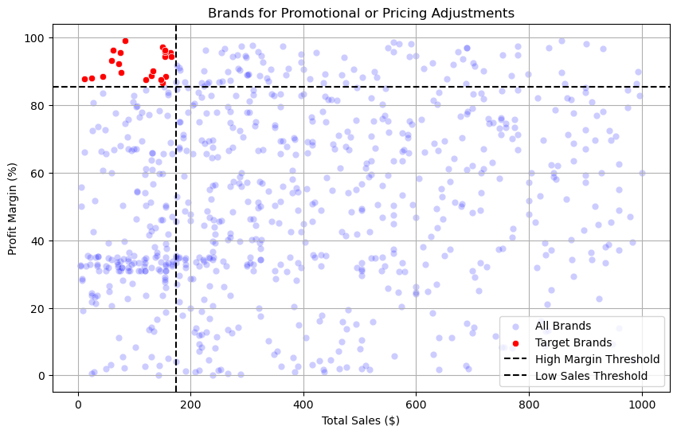
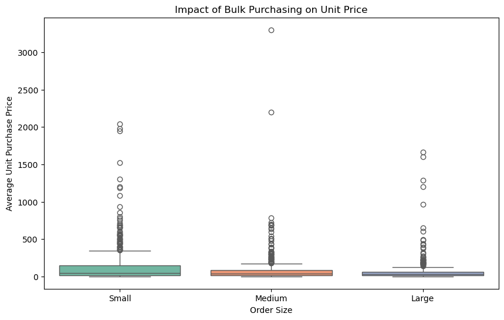
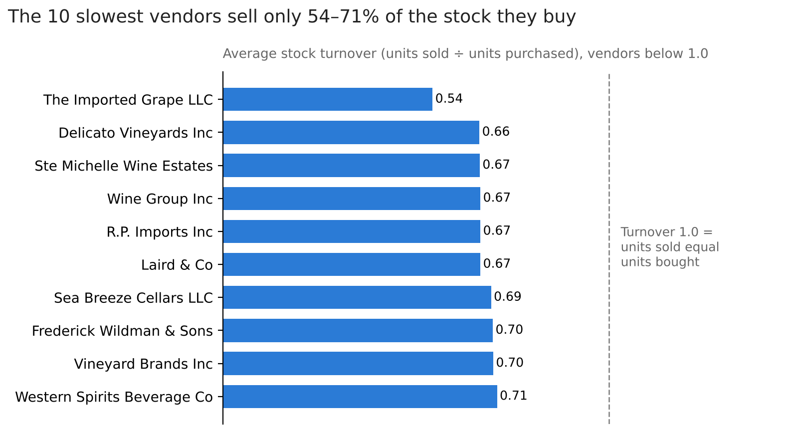
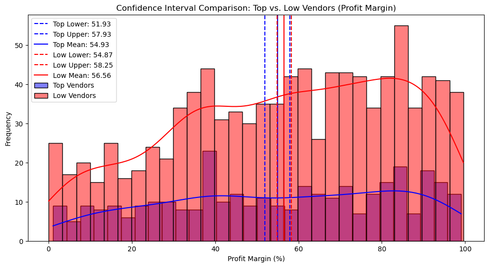
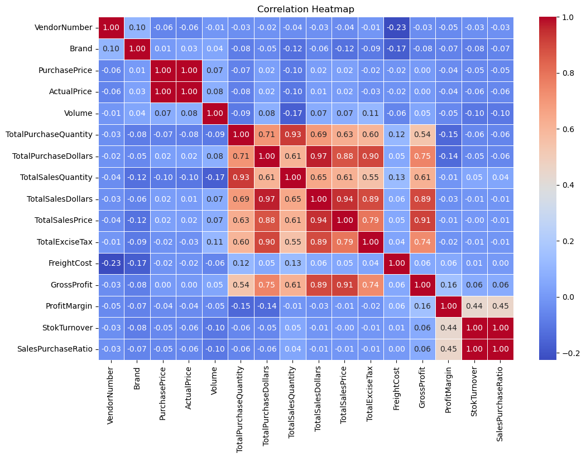
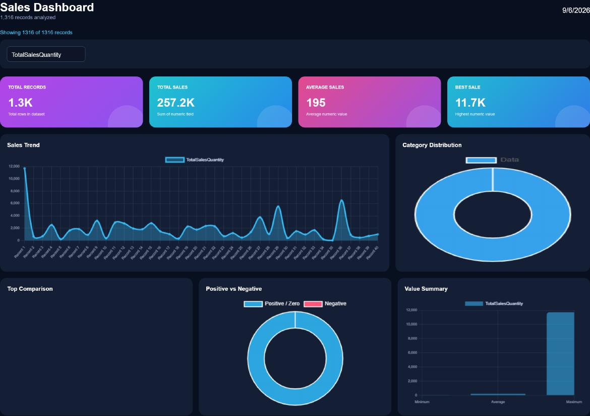

# Vendor Performance Analysis

   

An end-to-end data analytics project that analyses vendor, brand, purchasing, sales and inventory data of a liquor and wine retailer using **SQL, Python and Power BI**. Six raw tables (over 2 million purchase rows and 2.5 million sales rows) are merged into one vendor-brand summary table, explored in Python and presented in a dashboard.

## Table of Contents

- [Business Problem](#business-problem)
- [Objectives](#objectives)
- [Dataset](#dataset)
- [Workflow](#workflow)
- [Tech Stack](#tech-stack)
- [Data Preparation](#data-preparation)
- [Key Findings](#key-findings)
- [Dashboard](#dashboard)
- [Recommendations](#recommendations)
- [Project Structure](#project-structure)
- [How to Run](#how-to-run)
- [Limitations and Known Issues](#limitations-and-known-issues)
- [Author](#author)

## Business Problem

Retail and wholesale businesses work with hundreds of vendors and thousands of brands. Without analysis they risk:

- **Inefficient pricing**, leading to losses on some products.
- **Poor inventory turnover**, tying up working capital in slow-moving stock.
- **Vendor dependency**, with too much volume concentrated in a few suppliers.

## Objectives

1. Identify underperforming brands that need promotional or pricing adjustments.
2. Determine the top vendors contributing to sales and gross profit.
3. Analyse the impact of bulk purchasing on unit cost.
4. Assess inventory turnover to reduce holding costs.
5. Investigate the profitability variance between high- and low-performing vendors.

## Dataset

Source: SQLite database `inventoryy.db` with six tables.

| Table | Records | Content |
|---|---|---|
| `begin_inventory` | 206,529 | Stock on hand at start of period (2024-01-01) |
| `end_inventory` | 224,489 | Stock on hand at end of period (2024-12-31) |
| `purchases` | 2,106,032 | Purchase orders by store, brand and vendor |
| `purchase_prices` | 12,261 | List price, purchase price, volume and vendor per brand |
| `sales` | 2,531,035 | Daily sales by store and brand, with excise tax |
| `vendor_invoice` | 5,543 | Invoice quantity, dollars and freight per purchase order |

> The database is large, so it is not included in this repository. Place your copy at `data/inventoryy.db`.

## Workflow





## Tech Stack

| Tool | Purpose |
|---|---|
| SQL / SQLite | Extraction, joins (CTEs) and storage |
| SQLAlchemy | Ingesting CSV files into the database |
| Python, Pandas, NumPy | Cleaning and aggregation |
| Matplotlib, Seaborn | Visualisation |
| SciPy | Confidence intervals and hypothesis testing |
| Jupyter Notebook | Analysis environment |
| Power BI | Interactive dashboard |

## Data Preparation

1. A SQL query with three CTEs (`FreightSummary`, `PurchaseSummary`, `SalesSummary`) builds one row per vendor and brand (10,505 rows) and is saved as `vendor_sales_summary`.
2. Cleaning: `Volume` converted to float, missing values set to 0, text fields trimmed.
3. Derived metrics:
   - **Gross Profit** = Total Sales Dollars − Total Purchase Dollars
   - **Profit Margin (%)** = Gross Profit ÷ Total Sales Dollars × 100
   - **Stock Turnover** = Total Sales Quantity ÷ Total Purchase Quantity
   - **Sales-to-Purchase Ratio** = Total Sales Dollars ÷ Total Purchase Dollars
4. Records with Gross Profit ≤ 0, Profit Margin ≤ 0 or Sales Quantity = 0 were removed, leaving **1,316 valid records** (about 12.5% of the raw table). 2,756 raw rows had no sales at all.

## Key Findings

### 1. Sales are concentrated in a few vendors and one brand

Martignetti Companies ($508.8K), Ultra Beverage Company ($380.2K) and Jim Beam Brands ($374.9K) lead vendor sales. **Jim Beam Traveler** sold $266.1K, about seven times the next-best brand.



### 2. Purchasing is concentrated

The top 10 vendors account for about **74%** of purchase dollars; Martignetti and Jim Beam hold 15% each. This is a supply-chain risk.



### 3. Low-sales, high-margin brands

Brands in the bottom 15% of sales (≤ $174.41) and top 15% of margin (≥ 85.48%) earn a lot per unit but sell little, for example *Three Olives Grape Vodka* (99.2% margin) and *Dr McGillicuddy's Apple Pie* (96.3%). They are good targets for promotion or repricing.



### 4. Bulk purchasing lowers unit price

| Order size | Average unit price |
|---|---|
| Small | $139.34 |
| Medium | $90.73 |
| Large | $69.51 |

Large orders are about 50% cheaper per unit than small orders.



### 5. Slow-moving inventory

Ten vendors have average stock turnover of only 0.54–0.71. The slowest are The Imported Grape LLC (0.54), Delicato Vineyards (0.66), Ste Michelle Wine Estates (0.67), Wine Group (0.67) and R.P. Imports (0.67). Capital tied up in unsold stock is highest for Frederick Wildman & Sons, Delicato Vineyards and Trinchero Family Estates.



### 6. Profit margins differ by vendor tier

| Group | Mean margin | 95% CI |
|---|---|---|
| Top-performing (sales ≥ 75th percentile) | 54.93% | 51.93% – 57.93% |
| Low-performing | 56.56% | 54.87% – 58.25% |

A Welch two-sample t-test gives **t = 3.59, p = 0.0004**, so the difference in profit margin is statistically significant.



### 7. Correlations

Purchase and sales quantity are almost perfectly correlated (0.999). Profit margin falls slightly as sales price rises (−0.179), and faster stock turnover does not guarantee higher profit.



## Dashboard

The cleaned table was exported as `clean_data1.csv` and used to build the dashboard in Power BI.



## Recommendations

- **Promote** high-margin, low-sales brands with bundles, display placement or small discounts.
- **Consolidate orders** with fast-turning vendors to capture bulk pricing.
- **Reduce re-orders** from vendors with stock turnover below 1 and clear slow stock.
- **Diversify suppliers** to reduce dependence on the top 10 vendors.
- **Review loss-making products** for repricing or delisting.
- **Automate** the SQL and Python pipeline so the analysis refreshes each period.

## Project Structure

```
Vendor-Performance-Analysis/
├── data/
│   └── inventoryy.db              # add your copy here (not uploaded: large file)
├── notebooks/
│   ├── Explotery_Data_Analisis.ipynb      # SQL exploration and summary table
│   └── vendor_Performance_Analisis.ipynb  # EDA, statistics, insights
├── scripts/
│   ├── ingestion_db.py            # loads CSV files into SQLite
│   └── get_vendor_summary.py      # builds vendor_sales_summary
├── powerbi/
│   └── vendor_performance_dashboard.pbix  # add your Power BI file here
├── images/                        # charts used in this README
├── reports/
│   └── Vendor_Performance_Analysis_Final_Report.docx
├── requirements.txt
└── README.md
```

## How to Run

```bash
# 1. Clone the repository
git clone https://github.com/<your-username>/Vendor-Performance-Analysis.git
cd Vendor-Performance-Analysis

# 2. Install dependencies
pip install -r requirements.txt

# 3. Add the database at data/inventoryy.db

# 4. Build the summary table (run from the project root)
python scripts/get_vendor_summary.py

# 5. Open the analysis notebooks
jupyter notebook
```

Run `Explotery_Data_Analisis.ipynb` first, then `vendor_Performance_Analisis.ipynb`. Open the `.pbix` file in Power BI Desktop to explore the dashboard.

## Limitations and Known Issues

- Results describe only the 1,316 profitable, sold vendor-brand records; loss-making and unsold products are excluded, so margins are overstated for the whole business.
- Freight is calculated per vendor and repeated on each brand row, so row-level freight is overstated.
- Purchases are joined to `purchase_prices` on `Brand` only; adding `VendorNumber` to the join is safer.
- `UnitPurchasePrice` in the notebook uses sales dollars ÷ purchase quantity; a true unit purchase price uses purchase dollars.
- The low-performing group's confidence interval in the notebook uses `>=` instead of `<=` (the t-test is correct).

## Author

**Ganesh Jalindar Waghmare**
Data Analytics project · Python · SQL · SQLite · Pandas · Matplotlib · Seaborn · SciPy · Power BI
[email](ganeshwaghmare0810@gmail.com)

[GitHub](https://github.com/ganeshwaghmare0810-ship-it) 
· [LinkedIn](www.linkedin.com/in/ganesh-waghmare-71670b383>)

## License

This project is for educational and portfolio purposes.
